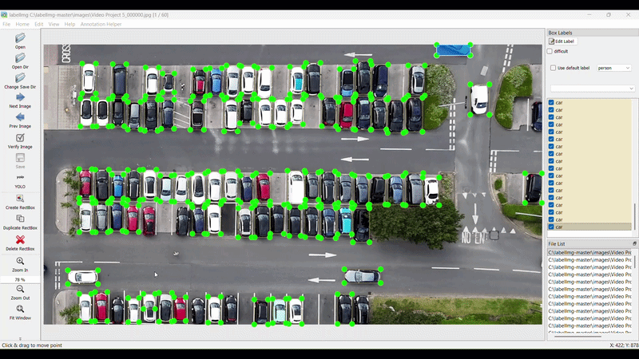
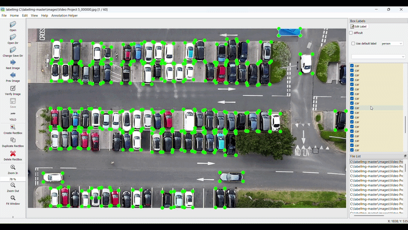

# LabelImg Plus

**LabelImg Plus** is an enhanced version of LabelImg built for faster and more practical bounding-box annotation workflows.

It keeps the familiar LabelImg experience while adding a powerful **Annotation Helper** for batch editing, selective actions, and model-assisted prediction.

## Features

### Core LabelImg Features

LabelImg Plus keeps the standard LabelImg workflow for manual annotation, including common shortcuts and image-by-image labeling.

Examples:

* Create bounding boxes
* Edit labels
* Save annotations
* Move to previous / next image
* Use existing LabelImg shortcuts such as `W` to create a box

### LabelImg-plus (Annotation Helper) Features

Annotation Helper is integrated into the same window and is designed to reduce repetitive work during annotation.

It helps with:

* deleting labels across an index range
* propagating labels to later images
* changing label classes in bulk
* running prediction on full images
* running prediction only inside a selected area


## ⚠️ Current Format Support

LabelImg Plus currently supports **YOLO format (.txt)** for all annotation operations.

Support for additional formats is under development and will be available in future releases:
- Pascal VOC (.xml)
- CreateML (.json)

---

## 📁 File Structure

```
labelimg/
├── annotation_helper/
│   ├── models/                         # Place your trained or pretrained PyTorch (.pt) models here
│   └── annotation_helper_current.py    # Main Annotation Helper logic and UI
│
├── labelImg.py                         # Main application entry point
├── libs/                               # Core LabelImg libraries
├── resources/                          # UI resources (icons, configs, etc.)
├── data/                               # Dataset-related files (optional)
├── requirements.txt
├── README.md
└── LICENSE
```

## Installation

### Recommended Python Version

Use **Python 3.10** for best compatibility.

### 1. Create a virtual environment

On Windows:

```bash
python -m venv lbl_env
lbl_env\Scripts\activate
```

On Linux / macOS:

```bash
python3.10 -m venv lbl_env
source lbl_env/bin/activate
```

### 2. Install LabelImg Plus

```bash
pip install labelimg-plus
```

---

## Run

After installation, start LabelImg Plus with:

```bash
labelImg.py
```

If your setup supports launching the script directly with dataset arguments, you can also run it like this:

```bash
python labelImg.py <image_dir> <classes.txt>
```

Example:

```bash
python labelImg.py images classes.txt
```

---

### Annotation Helper Window


---

## How to Open Annotation Helper

1. Launch **LabelImg Plus**
2. Open your dataset as usual
3. Click **Annotation Helper** from the top menu
4. The Annotation Helper UI will open inside the same window
5. Click **Home** from the top menu to return to the normal LabelImg page

---

## Annotation Helper Overview

The Annotation Helper page includes:

* **Image Navigation**

  * `Index`
  * `End`
  * `Load`

* **Select Area Mode**

  * used when you want to work only on a specific region

* **Actions**

  * Delete
  * Propagate
  * Change Class

* **Model & Predict**

  * model selector
  * Reload Models
  * Predict

* **Selected boxes**

  * shows currently selected bounding boxes

* **Undo**

  * restores the last performed helper action

---

## Feature Guide

# 1. Delete

Delete supports two workflows:

## 1A. Normal Delete

Use this when you want to delete:

* a selected label
* or a class across a range of images

### Steps

1. Open **Annotation Helper**
2. Enter the start image in **Index**
3. Enter the last image in **End**
4. In the image, select the target bounding box if needed
5. Choose **Delete**
6. If you want to delete by class, use the available class selection
7. Click **Apply Action**

### Typical use cases

* remove a wrong box from multiple images
* remove all labels of a specific class in a selected range

---

## 1B. Delete a Specific Label Using Select Area Mode

Use this when there are many objects of the same class, but you want to delete only one specific object.

### Steps

1. Open **Annotation Helper**
2. Set **Index** and **End**
3. Enable **Select Area Mode**
4. Draw a small box around the specific object you want to target
5. Choose **Delete**
6. Click **Apply Action**

### Why this is useful

If many labels have the same class in the same image range, Select Area Mode helps target only the intended one.

### Screenshot


```md

```

---

# 2. Propagate

Propagate is useful when an object stays in the same position across multiple images.

Examples:

* parked car
* TV
* fixed monitor
* other static objects

### Steps

1. Open **Annotation Helper**
2. Set **Index** to the current image
3. Set **End** to the last target image
4. Select the bounding box you want to copy forward
5. Choose **Propagate**
6. Click **Apply Action**

### Result

The selected label is copied across the entered range.

### Screenshot


```md

```

---

# 3. Change Class

Change Class supports two workflows:

## 3A. Normal Change Class

Use this when you want to change:

* one selected label
* or all labels of one class across a selected range

Example:
A `person` was accidentally labeled as `dog`.

### Steps

1. Open **Annotation Helper**
2. Set **Index** and **End**
3. Choose **Change Class**
4. Select the wrong class in **Old Class**
5. Select the correct class in **New Class**
6. If needed, select the specific box directly in the image
7. Click **Apply Action**


## 3B. Change Only One Specific Object Using Select Area Mode

Use this when there are many labels of the same class in the selected range, but you want to change only one specific object.

### Steps

1. Open **Annotation Helper**
2. Set **Index** and **End**
3. Enable **Select Area Mode**
4. Draw a small box around the specific object
5. Choose **Change Class**
6. Select **Old Class**
7. Select **New Class**
8. Click **Apply Action**

### Why this is useful

If multiple objects share the same class, this allows changing only the intended one.

### Screenshot


```md

```

---

# 4. Prediction

Prediction supports two workflows:

## 4A. Normal Prediction

Use this when you want to run prediction on the full image.

### Steps

1. Open **Annotation Helper**
2. Set **Index** and **End**
3. In **Model & Predict**, choose a model from the dropdown
4. If your model is not listed, click **Reload Models**
5. Keep **Select Area Mode** turned off
6. Click **Predict**

### Result

Prediction runs on the full image for all images in the selected range.

---

## 4B. Crop Prediction

Use this when you want to run prediction only inside a selected region.

### Steps

1. Open **Annotation Helper**
2. Set **Index** and **End**
3. Enable **Select Area Mode**
4. Draw a box around the target region
5. Select a model from the **Model** dropdown
6. If needed, click **Reload Models**
7. Click **Predict**

### Result

Prediction is applied only inside the selected area.

### Why this is useful

This is helpful when:

* the image has many unrelated objects
* you only want to detect in one region
* you want better control over prediction area

## LabelImg Shortcuts

LabelImg Plus keeps the standard LabelImg workflow and shortcuts.

Common examples:

* `W` → create bounding box
* `Ctrl + S` → save
* `A` / `D` → previous / next image
* `Delete` → delete selected box


---

## Why LabelImg Plus

LabelImg Plus is designed to make annotation faster by combining:

* manual labeling
* helper-based batch editing
* model-assisted prediction
* targeted area-based operations

This makes it especially useful for large datasets and repetitive annotation workflows.

---

## 👨‍💻 Authors & Credits

### LabelImg Plus (Enhanced Version)

Developed and maintained by **Duna Keshav Rao**

This version extends the original LabelImg with advanced features such as:

* Annotation Helper
* Batch operations (Delete, Propagate, Change Class)
* YOLO-based prediction system
* Improved UI workflow and integrated tools

---

### Original LabelImg

LabelImg was originally developed by:

* Tzutalin
* And other open-source contributors

GitHub: https://github.com/tzutalin/labelImg

---

### Acknowledgement

LabelImg Plus is built on top of the original LabelImg project.
Special thanks to the original developers and contributors for creating a solid foundation for image annotation.

This project continues that vision by enhancing usability, automation, and workflow efficiency for modern computer vision tasks.
