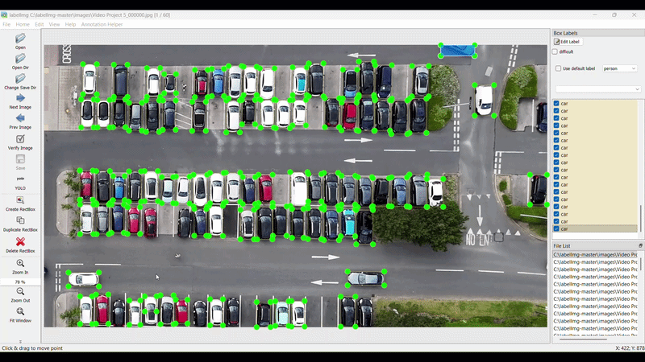
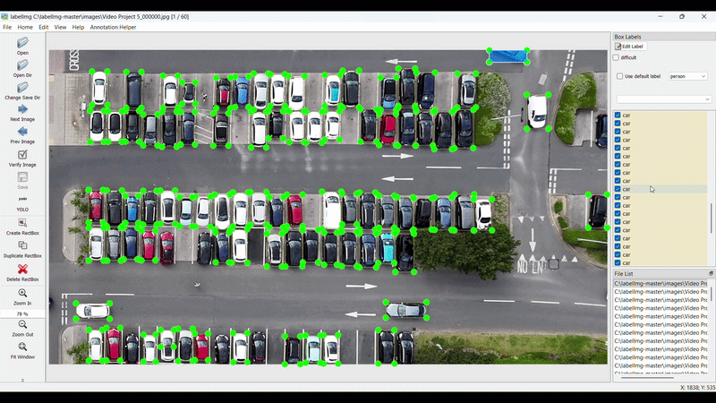

# LabelImg Plus

**LabelImg Plus** is an enhanced version of LabelImg built for faster and more practical bounding-box annotation workflows.

It keeps the familiar LabelImg experience while adding a powerful **Annotation Helper** for batch editing, selective actions, and model-assisted prediction.

## Features

### Core LabelImg Features

LabelImg Plus keeps the standard LabelImg workflow for manual annotation, including common shortcuts and image-by-image labeling.

Examples:

* Create bounding boxes
* Edit labels
* Save annotations
* Move to previous / next image
* Use existing LabelImg shortcuts such as `W` to create a box

### Main-window Batch Features

The former Annotation Helper features are integrated into the normal LabelImg
window through an **Actions** menu, keyboard shortcuts, and a searchable
Action Palette. There is no separate helper page.

It helps with:

* selecting all boxes, boxes by class, or a canvas area
* deleting labels across an image range
* propagating selected boxes to later images
* changing label classes in bulk
* running prediction on full images or only inside a selected area
* SAM 2 tracking and optional Kaggle T4 x2 offload

### Optional: Kaggle T4 x2 Offload

Heavy YOLO prediction and Dynamic SAM 2 tracking can run on Kaggle's 2x T4
GPUs instead of the local machine.  Models/checkpoints are uploaded once to a
private Kaggle weights dataset; the current images folder is uploaded once per
app session.  Later clicks send only a small command (~0.5-1 KB), reuse the
fixed kernel, and return only YOLO coordinates.  The changed frame is shown in
LabelImg (with Undo).  A **Cancel Kaggle job** button stops a queued/running
kernel.  T4 x2 is tried first; after a fixed 1-minute queue it tries L4 x1,
H100, then A100.  If no GPU is allocated the job stops (CPU is not used), and
LabelImg shows the reason.  **Kaggle setup → Check GPUs** probes the actual
GPUs first.  Closing LabelImg deletes the session image dataset.

Setup, quotas, troubleshooting and the full architecture are in
[annotation_helper/KAGGLE_SAM2.md](annotation_helper/KAGGLE_SAM2.md).

## ⚠️ Current Format Support

LabelImg Plus currently supports **YOLO format (.txt)** for all annotation operations.

Support for additional formats is under development and will be available in future releases:
- Pascal VOC (.xml)
- CreateML (.json)

---

## 📁 File Structure

```
labelimg/
├── annotation_helper/
│   ├── models/                         # Place your trained or pretrained PyTorch (.pt) models here
│   ├── kaggle_ui.py                    # Optional Kaggle T4 x2 UI/threads
│   ├── KAGGLE_SAM2.md                  # Cloud offload setup + troubleshooting
│   └── annotation_helper_current.py    # Main Annotation Helper logic and UI
├── kaggle_bridge/                      # Kaggle job bundling, CLI wrapper, kernel runner
│
├── labelImg.py                         # Main application entry point
├── libs/                               # Core LabelImg libraries
├── resources/                          # UI resources (icons, configs, etc.)
├── data/                               # Dataset-related files (optional)
├── requirements.txt
├── README.md
└── LICENSE
```

## Installation

### Recommended Python Version

Use **Python 3.10** for best compatibility.

### 1. Create a virtual environment

On Windows:

```bash
python -m venv lbl_env
lbl_env\Scripts\activate
```

On Linux / macOS:

```bash
python3.10 -m venv lbl_env
source lbl_env/bin/activate
```

### 2. Install LabelImg Plus

```bash
pip install labelimg-plus
```

---

## Run

After installation, start LabelImg Plus with:

```bash
labelImg.py
```

If your setup supports launching the script directly with dataset arguments, you can also run it like this:

```bash
python labelImg.py <image_dir> <classes.txt>
```

Example:

```bash
python labelImg.py images classes.txt
```

---

### Main-window Actions

Every former Annotation Helper feature now lives in the normal LabelImg
window. There is no separate helper page to open or navigate to.

Open the **Actions** menu, use a shortcut, or press `Ctrl+Shift+H` for the
searchable **Action Palette**. Each action opens a compact dialog with only
the options it needs.

| Action | Shortcut |
| --- | --- |
| Select all boxes | `Ctrl+Alt+A` |
| Select boxes by class | `Ctrl+Shift+B` |
| Clear selection | `Ctrl+Shift+X` |
| Select area on canvas | `Ctrl+Alt+R` |
| Delete boxes | `Ctrl+Alt+D` |
| Change class | `Ctrl+Shift+C` |
| Propagate selected boxes | `Ctrl+Alt+F` |
| YOLO predict | `Ctrl+Shift+Y` |
| SAM 2 track | `Ctrl+Shift+T` |
| Kaggle controls | `Ctrl+Shift+K` |
| Undo last label action | `Ctrl+Alt+Z` |
| Action Palette | `Ctrl+Shift+H` |
| Keyboard shortcut help | `Ctrl+Shift+F1` |

### Selection

* Click a box to select it.
* `Ctrl+click` adds or removes a box from the multi-selection.
* The status bar shows `Selected: N box(es)`.
* `Ctrl+Alt+R` starts area mode; drag a rectangle on the image and release.
  `Esc` cancels area mode.
* Delete, Change, Propagate, Predict and SAM 2 can all use the current
  selection or the orange canvas area as a filter.

All Actions read and write **YOLO `.txt`** labels. The app switches to the
YOLO format automatically and keeps `classes.txt` in sync with the main
window before saving.

---

## Feature Guide

# 1. Delete

Delete supports two workflows:

## 1A. Normal Delete

Use this when you want to delete:

* a selected label
* or a class across a range of images

### Steps

1. Open the **Actions** menu (or use the shortcut)
2. Choose the target frames (current frame, range, or all)
3. Select the target bounding box(es) on the canvas if needed
4. Choose the class / selection / area filters
5. Click the action button in the compact dialog

### Typical use cases

* remove a wrong box from multiple images
* remove all labels of a specific class in a selected range

---

## 1B. Delete a Specific Label Using Select Area Mode

Use this when there are many objects of the same class, but you want to delete only one specific object.

### Steps

1. Open the **Actions** menu (or use the shortcut)
2. Choose the target frames (current frame, range, or all)
3. Press `Ctrl+Alt+R` and drag a small box around the specific object
4. Open **Delete boxes** and keep the area filter checked
5. Click the action button in the compact dialog

### Why this is useful

If many labels have the same class in the same image range, Select Area Mode helps target only the intended one.

### Screenshot


```md

```

---

# 2. Propagate

Propagate is useful when an object stays in the same position across multiple images.

Examples:

* parked car
* TV
* fixed monitor
* other static objects

### Steps

1. Open the **Actions** menu (or use the shortcut)
2. Select the bounding box(es) you want to copy forward
3. Choose the target frame range, or use **Choose frames...** in the dialog
4. Click the action button in the compact dialog

### Result

The selected label is copied across the entered range.

### Screenshot


```md

```

---

# 3. Change Class

Change Class supports two workflows:

## 3A. Normal Change Class

Use this when you want to change:

* one selected label
* or all labels of one class across a selected range

Example:
A `person` was accidentally labeled as `dog`.

### Steps

1. Open the **Actions** menu (or use the shortcut)
2. Choose the target frames (current frame, range, or all)
3. Select the wrong class in **Old class**
4. Select the correct class in **New class**
5. If needed, select the specific box(es) on the canvas first
6. Click the action button in the compact dialog


## 3B. Change Only One Specific Object Using Select Area Mode

Use this when there are many labels of the same class in the selected range, but you want to change only one specific object.

### Steps

1. Open the **Actions** menu (or use the shortcut)
2. Choose the target frames (current frame, range, or all)
3. Press `Ctrl+Alt+R` and drag a small box around the specific object
4. Open **Change class** and keep the area filter checked
5. Select **New class** and click the action button

### Why this is useful

If multiple objects share the same class, this allows changing only the intended one.

### Screenshot


```md

```

---

# 4. Prediction

Prediction supports two workflows:

## 4A. Normal Prediction

Use this when you want to run prediction on the full image.

### Steps

1. Open the **Actions** menu (or use the shortcut)
2. Choose the target frame range
3. Choose a model from the dropdown in the dialog
4. If your model is not listed, use **Browse...**
5. Leave the area filter unchecked
6. Click **Run predict**

### Result

Prediction runs on the full image for all images in the selected range.
Tick **Keep existing boxes and add predictions** to merge instead of replace.

---

## 4B. Crop Prediction

Use this when you want to run prediction only inside a selected region.

### Steps

1. Open the **Actions** menu (or use the shortcut)
2. Choose the target frame range
3. Press `Ctrl+Alt+R` and drag a box around the target region
4. Choose a model in the dialog (or use **Browse...**)
5. Keep the area filter checked
6. Click **Run predict**

### Result

Prediction is applied only inside the selected area.

### Why this is useful

This is helpful when:

* the image has many unrelated objects
* you only want to detect in one region
* you want better control over prediction area

### SAM 2 and Kaggle

* `Ctrl+Shift+T` opens SAM 2 tracking for the selected box(es).
* `Ctrl+Shift+K` opens Kaggle settings, job history, session upload, and
  connection/GPU checks.
* Tick **Run on Kaggle** inside the Predict or SAM 2 dialog to run the job on
  a T4 x2 kernel. Images are uploaded once per batch; later clicks send only
  the command.
* **Undo last label action** (`Ctrl+Alt+Z`) restores the previous label-file
  snapshot after any local or Kaggle batch action.

## LabelImg Shortcuts

LabelImg Plus keeps the standard LabelImg workflow and shortcuts.

Common examples:

* `W` → create bounding box
* `Ctrl + S` → save
* `A` / `D` → previous / next image
* `Delete` → delete selected box


---

## Why LabelImg Plus

LabelImg Plus is designed to make annotation faster by combining:

* manual labeling
* helper-based batch editing
* model-assisted prediction
* targeted area-based operations

This makes it especially useful for large datasets and repetitive annotation workflows.

---

## 👨‍💻 Authors & Credits

### LabelImg Plus (Enhanced Version)

Developed and maintained by **Duna Keshav Rao**

This version extends the original LabelImg with advanced features such as:

* main-window batch actions and shortcuts
* Batch operations (Delete, Propagate, Change Class)
* YOLO-based prediction system
* Improved UI workflow and integrated tools

---

### Original LabelImg

LabelImg was originally developed by:

* Tzutalin
* And other open-source contributors

GitHub: https://github.com/tzutalin/labelImg

---

### Acknowledgement

LabelImg Plus is built on top of the original LabelImg project.
Special thanks to the original developers and contributors for creating a solid foundation for image annotation.

This project continues that vision by enhancing usability, automation, and workflow efficiency for modern computer vision tasks.
